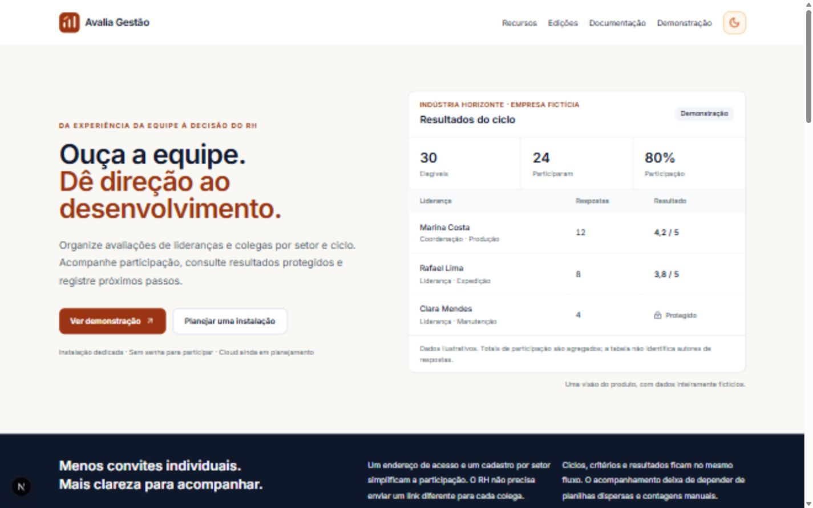

# Avalia Gestão

Avaliações de lideranças e colegas por setor, com participação única por ciclo, resultados protegidos e acompanhamento pelo RH. **Avalia Gestão Community v1.0.0-rc.2**. Código-fonte público em [Kaynanpp/avalia-gestao](https://github.com/Kaynanpp/avalia-gestao). Release Candidate: não é uma versão final.



[Modo escuro](docs/screenshots/product-dark.jpg) · [Celular](docs/screenshots/product-mobile.jpg)

## Funcionalidades

- Lideranças, colegas, setores, períodos e critérios.
- Participação por matrícula, sem conta para todos os funcionários; elegibilidade validada pelo servidor.
- Uma resposta por participante cadastrado, alvo e período, protegida por transação no Firestore.
- Controle de participação separado das respostas; mínimo configurável para exibir novos resultados.
- Relatórios, comentários protegidos, Excel, importação de colaboradores e planos de desenvolvimento.
- RH/ADMIN, senha temporária, troca obrigatória, sessões revogáveis e auditoria administrativa.
- Limites persistentes de tentativas, logs estruturados e health/readiness.
- Tema claro/escuro, site institucional e demonstração fictícia somente de leitura.

A matrícula identifica o cadastro, mas não autentica fortemente quem a digitou. A arquitetura reduz associação entre identidade e resposta; não promete anonimato absoluto contra comentários identificáveis, grupos pequenos ou operadores com acesso técnico. Avaliações históricas não recebem identidades inventadas.

## Stack e requisitos

Next.js 15, React 18, TypeScript, Tailwind/Radix, Firebase Authentication e Firestore, ExcelJS e Docker. Desenvolvimento: Node.js 24, Java 21 para emuladores e npm conforme packageManager. Instalação dedicada: Linux 64 bits, Docker/Compose e Firebase próprio. Um ambiente por empresa; Cloud multiempresa ainda não implementado.

## Desenvolvimento e configuração

```sh
npm ci
cp .env.example .env.local
# Gere um PARTICIPATION_SECRET aleatório e mantenha credenciais reais fora desse ambiente.
npm run emulators
# Em outro terminal:
npm run dev
```

Abra `/` para a aplicação, `/admin/login` para RH e `/produto` para o site. O exemplo aponta apenas para emuladores demo-* locais. Nunca use NEXT_PUBLIC_* para chaves privadas, segredos HMAC ou senhas.

Para dados fictícios, defina RH_SEED_PASSWORD com pelo menos oito caracteres e execute `npm run seed`. O script carrega .env.local e recusa projeto não demonstrativo ou emuladores fora de loopback.

## Testes

```sh
npm test
npm run lint
npm run typecheck
npm run build
npm audit --omit=dev --audit-level=high
npx firebase emulators:exec --only auth,firestore --project demo-avalia-gestao "npm run test:integration"
npx firebase emulators:exec --config firebase.recovery.json --only auth,firestore --project demo-avalia-gestao "npm run test:recovery"
```

Windows: a saída standalone pode exigir permissões de symlink. A referência de distribuição é o build Linux pelo lockfile. Suites HTTP/recuperação exigem emuladores novos e porta 3006 livre. O ensaio fictício não certifica recuperação SCRYPT de produção.

## Docker e self-hosting

```sh
cp .env.pi.example .env.pi
# Configure Firebase dedicado, credenciais, IP/porta e segredo no servidor.
docker compose --env-file .env.pi build
docker compose --env-file .env.pi run --rm --entrypoint node app scripts/check-environment.cjs
docker compose --env-file .env.pi up -d
```

Veja [instalação](docs/public/instalacao.md), [primeiros passos](docs/public/primeiros-passos.md) e [operação](docs/public/self-hosting.md). O Raspberry suporta Docker; internet/Firebase continuam necessários. A cópia do cartão não inclui o banco nem Authentication.

A marca da instalação é configurável por NEXT_PUBLIC_COMPANY_BRAND=generic e NEXT_PUBLIC_COMPANY_NAME. A instalação privada existente mantém sua marca quando essas opções não são alteradas. Assets de uma empresa precisam de autorização separada para redistribuição.

## Site e distribuição

`/produto`: Home, recursos, fluxo, privacidade, segurança e FAQ. Páginas de edições, demonstração, contato e sete guias. SITE_MODE=institutional apresenta o site na raiz e bloqueia a aplicação/APIs, exceto /api/health. É um modo para uma futura instalação separada; não transforma a aplicação dedicada em Cloud.

Domínio, repositório, instalação, documentação externa e contato são configurados por PRODUCT_*. Sem aprovação/configuração, não há links de GitHub, formulário que prometa envio, assinatura ou indexação pública. [Arquitetura do site](docs/INSTITUTIONAL-SITE.md).

## Documentação e segurança

- [Guias públicos](docs/public/README.md)
- [Recuperação](docs/BACKUP-RESTORE.md) e [deploy/rollback genérico](docs/DEPLOYMENT.md)
- [Testes HTTP](docs/INTEGRATION-TESTS.md)
- [Edições](docs/PRODUCT-EDITIONS.md) e [estratégia comercial](docs/COMMERCIALIZATION.md)
- [Checklist do release](docs/RELEASE-CHECKLIST.md)
- [Segurança](SECURITY.md), [contribuição](CONTRIBUTING.md), [changelog](CHANGELOG.md) e [roadmap](ROADMAP.md)

Credenciais, IPs operacionais, relatórios privados e backups ficam fora do Git e do contexto Docker. A revisão pré-publicação inclui todo o histórico: retirar informação do HEAD não limpa commits antigos.

## Licença e distribuição inicial

Copyright (C) 2026 Kaynan. Autoria declarada: Kaynan Fernandes, com auxílio do ChatGPT Work como ferramenta. Código próprio sob **AGPL-3.0-only**, [texto integral](LICENSE) e [escopo/copyright](COPYRIGHT). Dependências, fontes e avisos upstream mantêm suas licenças em [THIRD_PARTY_NOTICES.md](THIRD_PARTY_NOTICES.md). Sem garantia conforme a AGPL.

Community permite estudo, modificação, self-hosting e uso comercial conforme a licença; não foram retirados recursos. [Termos comerciais separados](COMMERCIAL-LICENSE.md) poderão ser oferecidos pelo titular; este documento não concede licença comercial. Marca segue [TRADEMARKS.md](TRADEMARKS.md).

Primeira distribuição: **fontes + receitas de build + documentação self-hosted**. Não distribuir imagem Docker pré-construída, standalone/bundle ou cartão Raspberry enquanto as obrigações nativas permanecerem BLOCKED. Build local para uso próprio não é publicação desses artefatos.

Ao disponibilizar versão modificada por rede, cumprir a oferta de fonte correspondente aos usuários exigida pela seção 13; preservar LICENSE/copyrights/notices. Definir acesso real à fonte da versão instalada sem publicar segredos ou dados; não inventar URL de GitHub antes da operação separada de publicação. Consulte [escopo e revisão de licenciamento](docs/LICENSING-STRATEGY.md).

Contribuições externas futuras dependem de CLA definitivo e verificação de direitos; [CLA.md](CLA.md) é rascunho, não vigente. DCO sozinho não concede relicenciamento comercial.
