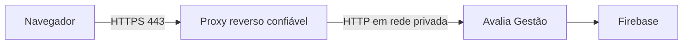

# Implantação do Avalia Gestão

## Desenvolvimento

1. Use Node.js 24 e `npm ci`.
2. Copie `.env.example` para `.env.local`.
3. Mantenha `NEXT_PUBLIC_USE_FIREBASE_EMULATOR=true`.
4. Gere `PARTICIPATION_SECRET` com 32 ou mais caracteres.
5. Inicie os emuladores e a aplicação.
6. Execute testes, lint, TypeScript e build antes de integrar mudanças.

O desenvolvimento nunca deve apontar por engano para o Firestore de produção.

## Instalação dedicada

### Requisitos

- Linux 64 bits, Docker Engine e Docker Compose.
- IP reservado ou nome interno estável.
- Projeto Firebase dedicado à empresa.
- Conta de serviço com o menor conjunto de permissões compatível.
- Cópia protegida dos segredos fora do servidor.

### Instalação

```sh
cp .env.pi.example .env.pi
# preencher .env.pi sem versionar
docker compose --env-file .env.pi build
docker compose --env-file .env.pi run --rm --entrypoint node app scripts/check-environment.cjs
docker compose --env-file .env.pi up -d
docker compose --env-file .env.pi ps
```

Valide:

```sh
curl --fail http://IP:PORT/api/health
curl --fail http://IP:PORT/api/ready
```

Crie o primeiro administrador conforme [Primeira instalação](FIRST-INSTALLATION.md). Aplique regras e índices do Firestore somente no projeto confirmado:

```sh
firebase use PROJETO_CONFIRMADO
firebase deploy --only firestore:rules,firestore:indexes
```

Em projeto existente, exporte e mescle os índices atuais antes de publicar `firestore.indexes.json`; o arquivo inicial não representa índices já criados no console. Nunca aceite exclusão de índice em produção sem revisar seu uso. Esta etapa não publicou regras ou índices no Firebase atual.

### Atualização e rollback

Antes de atualizar, registre o commit, marque a imagem atual e arquive o código/configuração. Construa a nova imagem sem remover a anterior. Após subir, valide health, readiness, login, página inicial e um fluxo de avaliação em ciclo de teste.

Para voltar, restaure o código da versão anterior ou aponte o Compose para a imagem marcada e execute `docker compose up -d`. Migrações precisam ser idempotentes e compatíveis com rollback; nenhuma migração destrutiva deve entrar no procedimento comum.

## Produção pública

Não publique diretamente a porta do contêiner. Use a sequência:



Requisitos antes da exposição:

- Domínio controlado e DNS aprovado.
- Certificado público automático no proxy, como Caddy ou Nginx com ACME.
- Firewall permitindo 80/443 ao proxy e bloqueando a porta interna da aplicação.
- Proxy substituindo `X-Forwarded-For` e `X-Forwarded-Proto`.
- `NEXT_PUBLIC_APP_URL=https://dominio` e `TRUST_PROXY=true`.
- Cookies Secure, readiness, logs, rate limiting e backup testado.
- HSTS somente depois de confirmar que todo o domínio funciona permanentemente em HTTPS.
- Política CSP testada em homologação; o frontend atual usa scripts gerados pelo Next.js e não deve receber uma CSP restritiva sem testes.

Exposição de rede, domínio, DNS e certificado dependem de autorização do proprietário.

## Futuro Cloud

O Cloud precisa de imagens imutáveis, configuração por secret manager, múltiplas instâncias, armazenamento central, readiness, rollout gradual, rollback automático e isolamento por organização. O design está em [MULTI-TENANCY-DESIGN.md](MULTI-TENANCY-DESIGN.md). A instalação dedicada atual representa uma única organização e não deve compartilhar o mesmo banco com outra empresa.

## Rotação de segredos

- Chave Firebase: crie uma nova, atualize a instalação, valide e só então revogue a antiga.
- `PARTICIPATION_SECRET`: configure o valor anterior em `PARTICIPATION_PREVIOUS_SECRETS` antes de trocar. A lista aceita valores separados por vírgula e preserva a verificação de tokens e chaves antigas. Mantenha as fontes enquanto houver participações associadas; não remova durante ciclos abertos. Planeje a janela e valide duplicidade antes de concluir.
- `RATE_LIMIT_SECRET`: pode ser trocado; contadores anteriores expiram pelo TTL, mas a janela de proteção recomeça.

Nunca mostre segredos em logs, comandos copiados para chamados ou documentação.

Faça rotação do segredo de participação somente com ciclos encerrados e uma janela sem gravações. Não mantenha réplicas com conjuntos de chaves incompatíveis: uma instância antiga pode não reconhecer documentos escritos pela chave nova. A lista de fontes anteriores preserva leitura/verificação; não substitui esse procedimento operacional.

## Candidato v1.0.0-rc.1 — preparação interna

Build e smoke devem usar diretório/contêiner separado, porta em loopback e projeto fictício, sem compartilhar volumes de configuração com produção. Registre o commit e o resultado antes do corte. A validação Linux é executada com Node 24 e o lockfile; o artefato ligado a projeto demo não deve substituir a instalação real sem reconstrução com sua configuração pública correta.

```sh
# No servidor, antes de qualquer troca; exemplos de tags, sem segredo.
docker tag IMAGEM_ATUAL produto:rollback-antes-rc1
# Build da instalação real somente após backup e recuperação completos.
docker compose --env-file .env.pi build
docker compose --env-file .env.pi up -d
# Em regressão, apontar Compose para a imagem preservada e recriar sem --build.
```

Não executar o corte enquanto recuperação Auth real, backup consistente e validação de login/configuração equivalente estiverem pendentes. O ensaio gratuito com dados fictícios é evidência do mecanismo, não backup do cliente. Nenhum índice/TTL ou migração é aplicado automaticamente pelo deploy.

## Site independente

Use `SITE_MODE=institutional`, sem FIREBASE_ADMIN_CLIENT_EMAIL/PRIVATE_KEY, e execute `config:check` antes de iniciar. Configuração desconhecida de SITE_MODE retorna indisponibilidade; não libera a aplicação por engano. O modo apresenta a raiz institucional e permite páginas do produto, robots/sitemap, marca do produto e health; rotas da aplicação são bloqueadas. Só configurar PRODUCT_INDEXING_ENABLED=true e URLs reais após autorização para publicação.

O artefato compartilhado ainda contém módulos da aplicação. A barreira de rotas deve permanecer ativa; a implantação deve ser separada da instalação privada e não receber suas credenciais. Nenhuma porta pública/DNS foi alterada nesta etapa.
